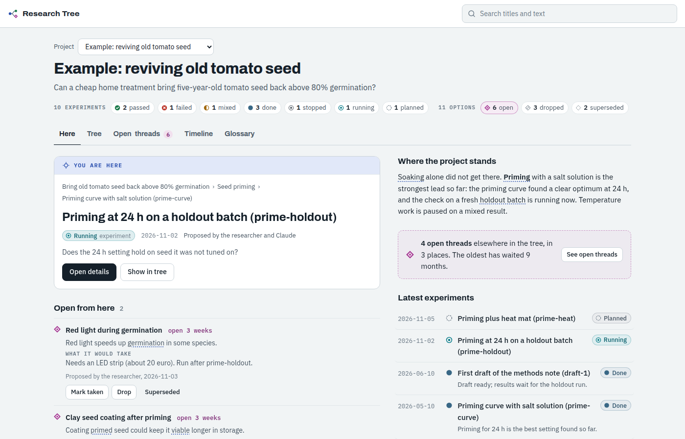
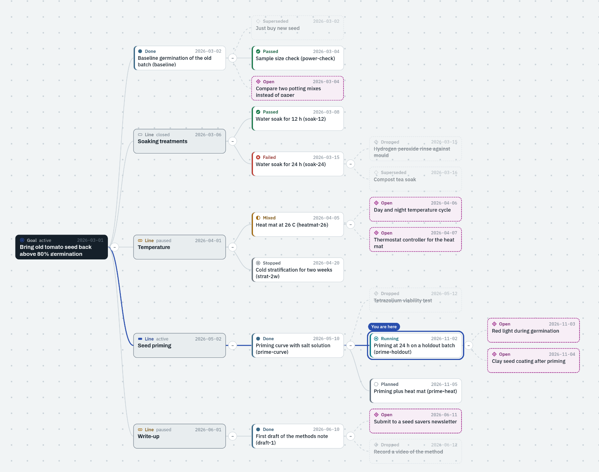
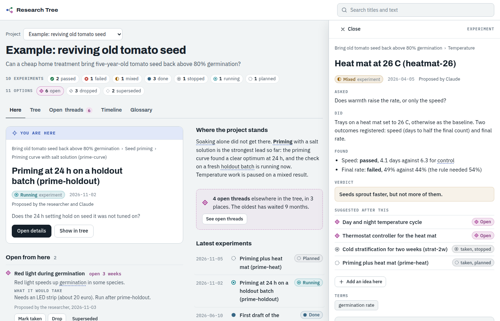
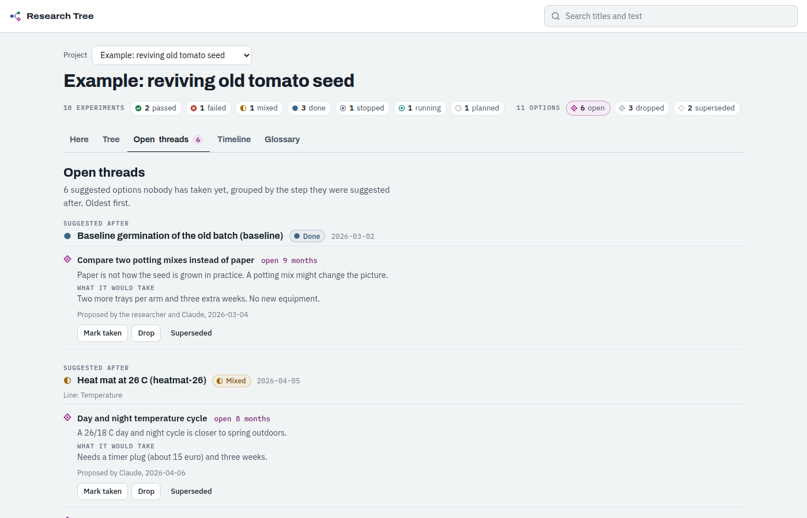
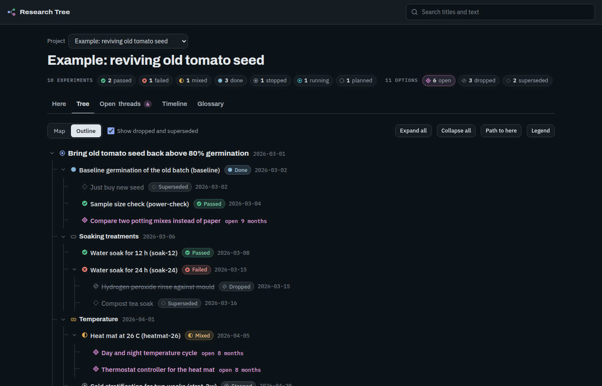
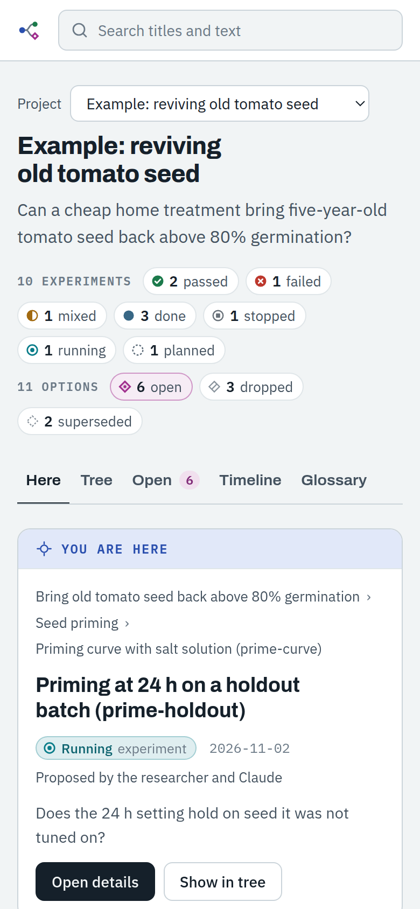

# Research Tree

A Claude Code skill that keeps a research project's history as a living tree, on a page you can open from any
device.



<sub>All screenshots show the made-up example project that ships with the skill (reviving old tomato seed), not
real data.</sub>

Long research gets lost: after each experiment several next steps are suggested, one is followed deep, the others
are forgotten, and months later nobody remembers why a direction was dropped. The Research Tree records:

- every experiment: what it asked, what was done, what was found, and a one-line verdict;
- every option suggested along the way, and whether it was taken, dropped, overtaken, or is still open;
- a glossary of the project's terms;
- where the work stands now ("you are here") and a short summary.

The page is a claude.ai artifact with a small database. Claude writes to it as the work goes; you read it, change a
status, write a note or add an idea from the page. One page holds any number of projects.

## What it looks like

**The tree.** Every experiment, line of work and suggested option, from the goal on the left to the latest step.
Shape and colour carry the status (passed, failed, mixed, running, planned, open, dropped); the path to "you are
here" is highlighted.



**One experiment.** What it asked, what was done, what was found and the verdict, with the options suggested after
it and whether each was taken. You can change a status, write a note or add an idea from here.



**Open threads and more.** Options nobody has taken yet, oldest first, so nothing suggested is forgotten. An outline
view, a timeline and a glossary of the project's terms; light and dark themes; works on a phone.

| Open threads | Outline, dark theme | Phone |
|---|---|---|
|  |  |  |

## Install

In Claude Code:

```
/plugin marketplace add gbay7/research-tree
/plugin install research-tree@research-tree
```

or from a terminal:

```
claude plugin marketplace add gbay7/research-tree
claude plugin install research-tree@research-tree
```

Requires Claude Code signed in to claude.ai (the skill uses the Artifact and ArtifactData tools) and Python 3 for
the helper scripts.

## Use

Ask Claude to "start a research tree for this project", or to "add this experiment to the research tree". In a
project that already has a tree, the skill keeps it current after every experiment and every set of suggested next
steps, and reads your notes and ideas from the page at the start of a session.

A session without the skill can still use a tree: every tree holds a `meta/guide` document with the data model and
the working rules. Point the session at the tree's link and ask it to read that document first.

## Contents

- `skills/research-tree/SKILL.md`: the workflow.
- `skills/research-tree/assets/research-tree.html`: the page, published as is.
- `skills/research-tree/assets/example.json`: two small example projects.
- `skills/research-tree/references/`: the data model and the working rules.
- `skills/research-tree/scripts/`: `validate.py` (check a seed file or an exported tree), `to_batches.py` (import a
  whole history in batches), `guide_doc.py` (build a tree's `meta/guide` document).
